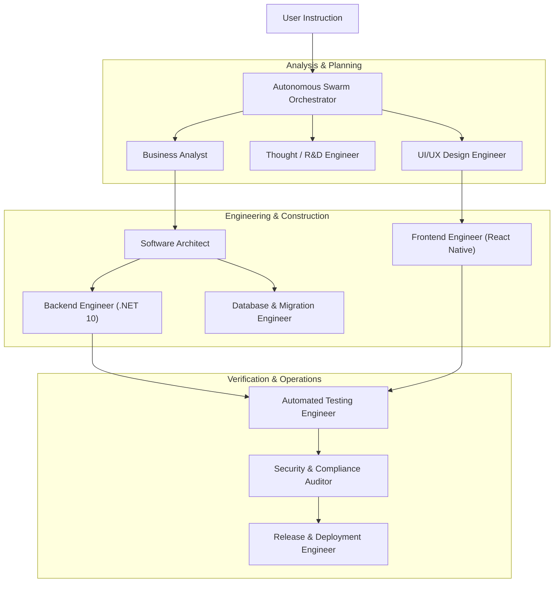

# Autonomous Engineering Swarm Integration Guide

## 1. Overview

`Unified Product` is fully integrated with the **Autonomous Engineering Swarm** (`autonomous-engineering-swarm`), an 18-agent autonomous software delivery framework.

## 2. Agent Swarm Topology

## 3. Registered Project Configuration

The Autonomous Engineering Swarm orchestrator maintains `Unified Product` under project key:
- **Project ID**: `proj-unified-product`
- **Name**: `Unified Product`
- **Root Path**: `D:\Projects\Unified Product`
- **Remote Origin**: `https://github.com/Ajain0311/Unified-Product.git`
- **Upstream Source**: `https://github.com/Ajain0311/SuperApp_V2.git`
- **Stack**: .NET 10.0 C#, React Native Expo, PostgreSQL, SignalR, Razorpay
- **Architectural Pattern**: Clean Layered Architecture (`Domain` -> `Application` -> `Infrastructure` -> `API`)

## 4. Operational Guidelines for Agents (Fast Execution)
1. **Canonical Rulebook**: All agent execution is governed by [AGENTS.md](../AGENTS.md). Direct execution and targeted verification take precedence over multi-step swarm handoffs.
2. **Never push to `upstream`** (`SuperApp_V2`). Only push to `origin` (`Unified-Product`).
3. **Preserve existing API contracts**. Modifying an endpoint route, status code, or response shape requires explicit versioning.
4. **Targeted Verification**: Run focused checks relevant to the code changed rather than blocking development on full-suite passes.
