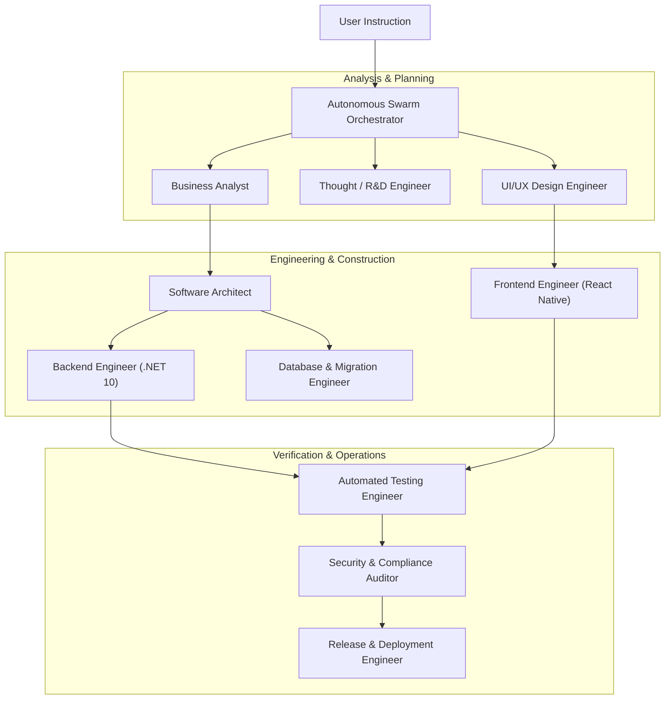

# Autonomous Engineering Swarm Integration Guide

## 1. Overview

`Unified Product` is fully integrated with the **Autonomous Engineering Swarm** (`autonomous-engineering-swarm`), an 18-agent autonomous software delivery framework.

## 2. Agent Swarm Topology

## 3. Registered Project Configuration

The Autonomous Engineering Swarm orchestrator maintains `Unified Product` under project key:
- **Project ID**: `proj-unified-product`
- **Name**: `Unified Product`
- **Root Path**: `D:\Projects\Unified Product`
- **Remote Origin**: `https://github.com/Ajain0311/Unified-Product.git`
- **Upstream Source**: `https://github.com/Ajain0311/SuperApp_V2.git`
- **Stack**: .NET 10.0 C#, React Native Expo, PostgreSQL, SignalR, Razorpay
- **Architectural Pattern**: Clean Layered Architecture (`Domain` -> `Application` -> `Infrastructure` -> `API`)

## 4. Operational Invariant Rules for Agents
1. **Never push to `upstream`** (`SuperApp_V2`). Only push to `origin` (`Unified-Product`).
2. **Preserve existing API contracts**. Modifying an endpoint route, status code, or response shape requires explicit versioning.
3. **Execute 5-State checks** on every frontend screen touch (Loading, Empty, Error, Success, Denied).
4. **Mandatory test passage**: All .NET unit and integration tests in `SuperApp.Tests` must pass before marking any task as complete.
